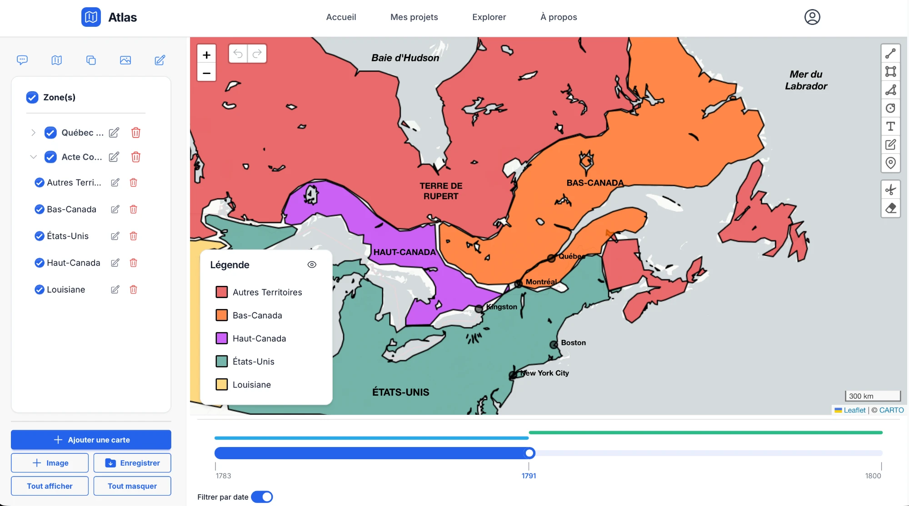

<div align="center">


# Atlas

**Créer, organiser et partager des cartes historiques pour l'enseignement de l'histoire et de la géographie.**

[](https://github.com/AtlasPMC68/Atlas/actions/workflows/ci.yml)
[](LICENSE)

[Fonctionnalités](#fonctionnalités) · [Démarrage rapide](#démarrage-rapide) · [Documentation](#documentation) · [Signaler un problème](#signaler-un-problème-ou-proposer-une-idée)



</div>

---

Les enseignants d'histoire et de géographie ont souvent du mal à trouver des cartes adaptées à leurs cours : trop chargées, ou dessinées chacune à sa façon, elles se comparent mal entre elles.

Atlas importe une carte existante (une image, une page de manuel numérisée), en extrait automatiquement les territoires, les formes et les noms de lieux, puis les replace sur une carte du monde commune. Les cartes de différentes époques peuvent ainsi être superposées, modifiées et comparées dans une même interface, puis partagées avec d'autres enseignants.

## Fonctionnalités

- **Import de cartes.** Téléversez l'image d'une carte : un assistant vous guide pour indiquer la région du monde, la légende et quelques points de repère.
- **Extraction automatique.** Atlas détecte les zones de couleur, les formes et les noms de lieux de la carte, et les transforme en éléments modifiables.
- **Géoréférencement.** Les éléments extraits sont replacés à leur vraie position sur la carte du monde, en s'appuyant sur des points de repère et sur le tracé des côtes.
- **Éditeur de carte.** Modifiez les zones, couleurs, contours et textes, ajoutez des formes, des flèches et des images, avec annuler / rétablir.
- **Légende.** La légende se construit automatiquement à partir des zones visibles et de leurs couleurs.
- **Ligne du temps.** Associez chaque carte à une période et suivez l'évolution des territoires d'une époque à l'autre.
- **Projets.** Regroupez plusieurs cartes dans un projet, privé ou public.
- **Explorer et partager.** Parcourez les projets publics de la communauté et enregistrez-en une copie pour l'adapter à vos cours.
- **Comptes utilisateurs.** Inscription, connexion et mot de passe oublié, gérés par Keycloak.

## Démarrage rapide

**Prérequis :** [Docker Desktop](https://www.docker.com/products/docker-desktop/) (ou Docker Engine avec Compose).

```bash
git clone https://github.com/AtlasPMC68/Atlas.git
cd Atlas
docker compose up -d --build
```

Le premier démarrage prend plusieurs minutes. Ouvrez ensuite **http://localhost**, puis créez un compte avec **S'inscrire**.

Pour afficher les fonds de carte, ajoutez une clé API [CARTO](https://carto.com/) : `cp .env.example .env`, puis remplissez `VITE_CARTO_API_KEY`.

Les tests, les migrations de base de données et le reste du travail en local sont décrits dans le [guide de développement](docs/developpement.md).

## Documentation

| Document | Pour qui |
|---|---|
| [Guide d'utilisation](docs/guide-utilisateur/README.md) | Les enseignants et toute personne qui utilise Atlas |
| [Guide de déploiement](docs/deploiement/README.md) | Mettre Atlas en ligne sur un serveur Oracle Cloud, le mettre à jour et le sauvegarder |
| [Guide de développement](docs/developpement.md) | Faire tourner Atlas en local, lancer les tests, modifier la base de données |
| [Architecture](docs/architecture.md) | Les services, le traitement d'une carte, l'organisation du code |
| [Géoréférencement](dev-docs/georeferencing.md) (en anglais) | Le détail technique du placement des cartes |

## Technologies

| | |
|---|---|
| **Frontend** | Vue 3, TypeScript, Vite, Tailwind CSS, DaisyUI, Leaflet |
| **Backend** | Python, FastAPI, SQLAlchemy, Celery, Redis |
| **Traitement d'image et de texte** | OpenCV, scikit-image, Shapely, Florence-2 |
| **Données et comptes** | PostgreSQL + PostGIS, Keycloak |
| **Infrastructure** | Docker Compose, Caddy, GitHub Actions |

## Signaler un problème ou proposer une idée

Vous avez trouvé un bogue ou vous aimeriez une nouvelle fonctionnalité ? Ouvrez une [issue](https://github.com/AtlasPMC68/Atlas/issues/new/choose) en décrivant ce que vous faisiez, ce qui s'est passé et ce que vous attendiez.

Pour contribuer au code, lisez le [guide de contribution](CONTRIBUTING.md).

## Contexte

Atlas a été réalisé dans le cadre du projet majeur de conception (PMC) du baccalauréat en génie informatique de l'Université de Sherbrooke.

## Licence

Atlas est distribué sous la [licence MIT](LICENSE).
