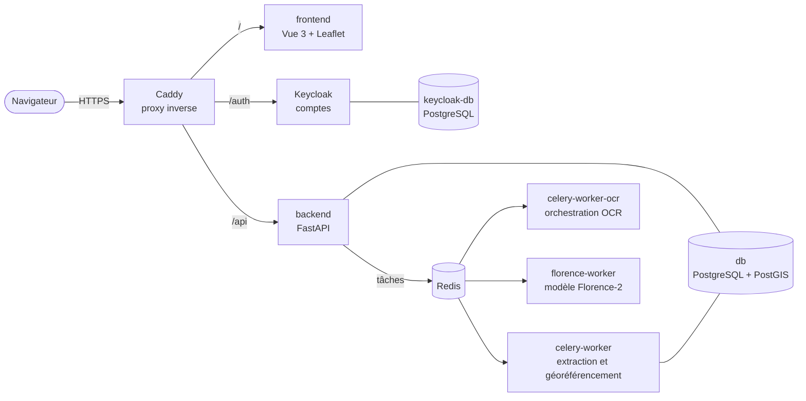

# Architecture

Vue d'ensemble de la façon dont Atlas est construit. Pour le détail des algorithmes de géoréférencement, voir la [documentation technique](../dev-docs/georeferencing.md) (en anglais).

## Les services

Atlas tourne entièrement dans des conteneurs Docker, décrits dans [`docker-compose.yml`](../docker-compose.yml). Seul Caddy est exposé ; tout le reste communique sur le réseau interne de Docker.



| Service | Rôle |
|---|---|
| `caddy` | Point d'entrée unique. Gère le HTTPS (Let's Encrypt) et redirige `/api`, `/auth` et le reste vers le bon service. Bloque la console admin Keycloak hors des IP autorisées. |
| `frontend` | Application Vue 3 + TypeScript (Vite, Tailwind/DaisyUI). La carte est affichée avec Leaflet. |
| `backend` | API REST FastAPI (Python). Gère les projets, les cartes, les éléments et lance les traitements. |
| `db` | PostgreSQL 17 avec PostGIS : projets, cartes et éléments géographiques. |
| `migrate` | S'exécute au démarrage, applique les nouvelles migrations SQL de [`Backend-Atlas/db/`](../Backend-Atlas/db/), puis s'arrête. |
| `keycloak` + `keycloak-db` | Gestion des comptes : inscription, connexion, mot de passe oublié. Le thème de connexion est dans [`keycloak/themes/`](../keycloak/themes/). |
| `redis` | File d'attente des tâches Celery. |
| `celery-worker` | Exécute les traitements lourds : extraction des couleurs et des formes, géoréférencement (file `default`). |
| `celery-worker-ocr` | Prépare l'extraction de texte et attend le résultat de Florence (file `maps_ocr`). |
| `florence-worker` | Fait tourner le modèle [Florence-2](https://huggingface.co/microsoft/Florence-2-base) pour lire le texte des cartes (file `florence`). Le code est dans [`Backend-Atlas/ocr-florence/`](../Backend-Atlas/ocr-florence/). |
| `flower` | Tableau de bord des tâches Celery, accessible seulement en local (port 5555). |

## Du fichier image à la carte interactive

L'import d'une carte se fait en deux temps : l'utilisateur donne quelques indications, puis les workers font le reste en arrière-plan.

1. **Téléversement.** L'image est envoyée au backend et rattachée à un projet.
2. **Saisie utilisateur.** Dans l'assistant d'import, l'utilisateur :
   - indique la zone du monde que couvre la carte ;
   - délimite la légende (ou indique qu'il n'y en a pas) ;
   - place des points de contrôle, ou laisse Atlas en trouver automatiquement (points SIFT) ;
   - choisit les couleurs et les formes à extraire, et active ou non l'extraction de texte.
3. **Extraction** (`celery-worker`). Les zones de couleur et les formes sont détectées sur l'image (OpenCV, scikit-image) et transformées en polygones.
4. **Lecture du texte** (`celery-worker-ocr` → `florence-worker`). Florence-2 détecte et lit les noms de lieux. Les noms sont comparés à un répertoire géographique hors ligne ([`Backend-Atlas/app/data/`](../Backend-Atlas/app/data/)) pour les placer sur la carte. L'utilisateur valide ensuite les textes non reconnus.
5. **Géoréférencement.** Les points de contrôle donnent une première transformation de l'image vers les coordonnées réelles. Elle est ensuite affinée en alignant le trait de côte dessiné sur le vrai trait de côte, puis les zones sont collées à la côte. Le code est dans [`Backend-Atlas/app/utils/georeferencing/`](../Backend-Atlas/app/utils/georeferencing/).
6. **Enregistrement.** Les éléments obtenus sont enregistrés en GeoJSON dans PostGIS et s'affichent dans l'éditeur, où l'utilisateur peut les modifier.

## Organisation du code

```
Atlas/
├── Backend-Atlas/          API FastAPI, workers Celery, tests pytest
│   ├── app/
│   │   ├── routers/        points d'entrée de l'API (projets, imports, utilisateurs…)
│   │   ├── services/       logique métier
│   │   ├── models/         modèles SQLAlchemy
│   │   ├── utils/          extraction, OCR, géoréférencement
│   │   └── tasks.py        tâches Celery
│   ├── db/                 migrations SQL
│   ├── ocr-florence/       worker Florence-2 (image Docker séparée)
│   └── tests/              tests unitaires et cas de géoréférencement
├── Frontend-Atlas/         application Vue 3
│   ├── src/views/          pages (accueil, projets, explorer, carte…)
│   ├── src/components/     composants (import, légende, ligne du temps…)
│   └── tests/              tests Vitest
├── keycloak/               configuration du realm et thème de connexion
├── docker/                 images Docker personnalisées (PostGIS)
├── docs/                   cette documentation
├── dev-docs/               documentation technique du géoréférencement
├── Caddyfile               configuration du proxy inverse
├── deploy.sh, rollback.sh  déploiement sur le serveur
└── docker-compose*.yml     services (développement et production)
```

## Technologies

| Domaine | Technologies |
|---|---|
| Frontend | Vue 3, TypeScript, Vite, Pinia, Vue Router, Tailwind CSS, DaisyUI, Leaflet, Leaflet-Geoman |
| Backend | Python, FastAPI, SQLAlchemy, Celery, Redis |
| Traitement d'image | OpenCV, scikit-image, NumPy, SciPy, Shapely |
| Texte | Florence-2 (Transformers, PyTorch), geonamescache |
| Données | PostgreSQL 17, PostGIS |
| Authentification | Keycloak |
| Infrastructure | Docker Compose, Caddy, GitHub Actions |
