# Guide de déploiement sur Oracle Cloud

Ce guide explique comment déployer Atlas sur un serveur Oracle Cloud à partir de zéro : créer le serveur, s'y connecter, lancer le déploiement, puis l'entretenir (mises à jour, retour arrière, base de données, sauvegardes).

**Objectif :** n'importe qui doit pouvoir reproduire le déploiement seul, en suivant ce document dans l'ordre.

**Ce que vous obtenez à la fin :** Atlas accessible en HTTPS à une adresse du type `https://<ip>.nip.io`, avec la connexion Keycloak, la base de données et les workers qui fonctionnent.

> [!NOTE]
> Remplacez ce qui est entre `< >` par votre valeur, par exemple `<ip>` par l'adresse IP de votre serveur.

## Sommaire

1. [Prérequis](#1-prérequis)
2. [Créer la VM sur Oracle Cloud](#2-créer-la-vm-sur-oracle-cloud)
3. [Ouvrir les ports 80 et 443 dans Oracle](#3-ouvrir-les-ports-80-et-443-dans-oracle)
4. [Se connecter à la VM en SSH](#4-se-connecter-à-la-vm-en-ssh)
5. [Installer Docker et récupérer le code](#5-installer-docker-et-récupérer-le-code)
6. [Premier déploiement](#6-premier-déploiement)
7. [Après le premier déploiement](#7-après-le-premier-déploiement)
8. [Mettre à jour l'application](#8-mettre-à-jour-lapplication)
9. [Quand quelque chose ne va pas](#9-quand-quelque-chose-ne-va-pas)
10. [Base de données](#10-base-de-données)
11. [Entretien du serveur](#11-entretien-du-serveur)
12. [Quitter le serveur ou changer de VM](#12-quitter-le-serveur-ou-changer-de-vm)

[Aide-mémoire](#aide-mémoire) · [Fichiers importants](#fichiers-importants)

## Comment Atlas tourne sur le serveur

Tout tourne dans des conteneurs Docker sur une seule machine virtuelle (VM). Seul Caddy est exposé à Internet, sur les ports 80 et 443 :

- `/api` → le backend (FastAPI)
- `/auth` → Keycloak (connexion des utilisateurs)
- tout le reste → le frontend (Vue)
- En arrière-plan, sans accès depuis Internet : PostgreSQL (PostGIS), Redis, les workers Celery, le worker OCR.

Caddy obtient automatiquement le certificat HTTPS auprès de Let's Encrypt. L'adresse `<ip>.nip.io` est un service gratuit qui pointe vers votre IP : pas besoin d'acheter un nom de domaine.

## 1. Prérequis

- **Un compte Oracle Cloud.** L'inscription demande une carte de crédit pour vérifier l'identité, mais l'offre « Always Free » suffit pour Atlas.
- **Une clé API CARTO** pour les fonds de carte, créée sur votre compte [CARTO](https://carto.com/). Sans clé, le site fonctionne mais les fonds de carte peuvent ne pas s'afficher.
- **Une vraie adresse courriel** pour le certificat HTTPS. Let's Encrypt refuse les adresses de test comme `admin@example.com`.
- **Un terminal avec SSH** : Terminal sur macOS ou Linux, PowerShell sur Windows (SSH y est déjà installé).

## 2. Créer la VM sur Oracle Cloud

Dans la console Oracle Cloud ([cloud.oracle.com](https://cloud.oracle.com)) :

1. Ouvrez le menu ☰ → **Compute** → **Instances**, puis cliquez sur **Create instance**.

   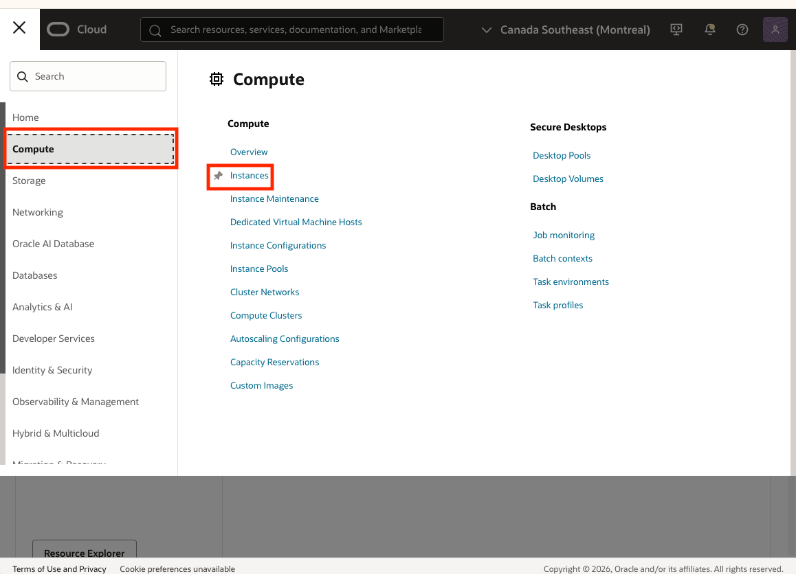
   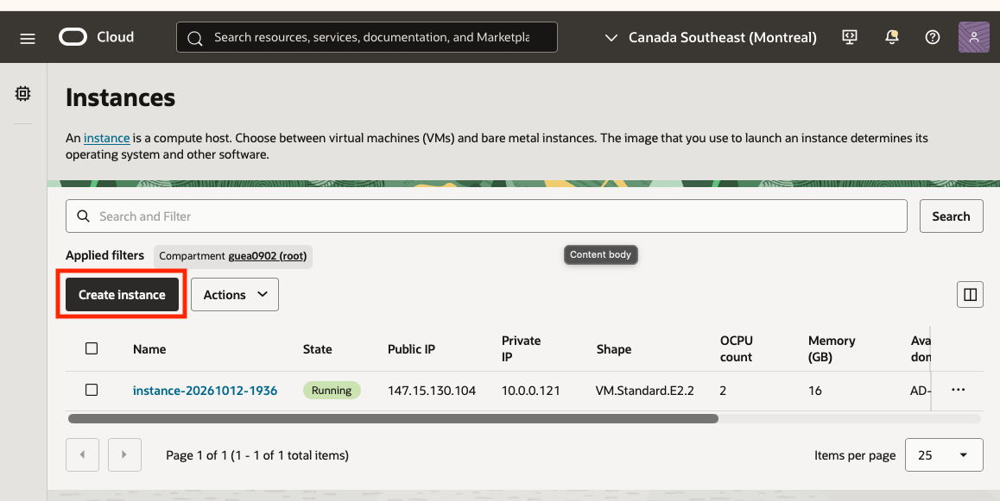

2. **Name** : donnez un nom, par exemple `atlas`.
3. **Image and shape** → **Edit** :
   - **Image** : cliquez sur **Change image** et choisissez **Canonical Ubuntu 24.04** (le script de déploiement est fait pour Ubuntu).
   - **Shape** : cliquez sur **Change shape** → **Ampere** → **VM.Standard.A1.Flex**. Mettez **4 OCPU** et **24 Go** de mémoire, le maximum gratuit. Le worker OCR a besoin de mémoire.

   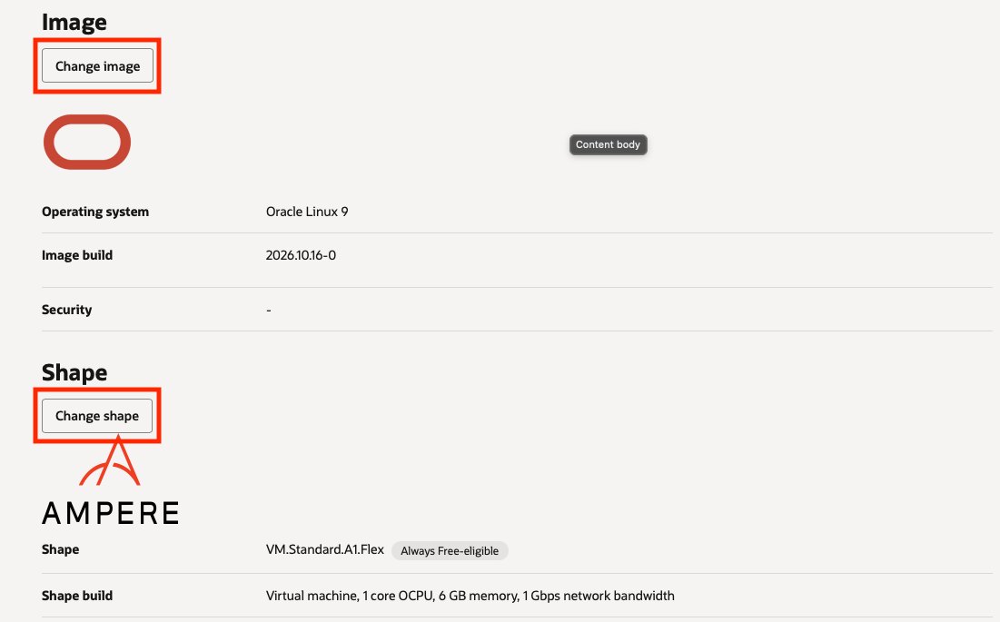
   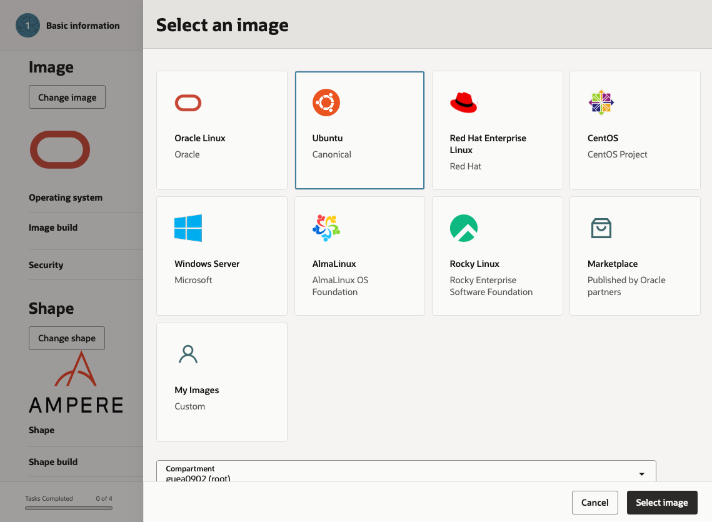
   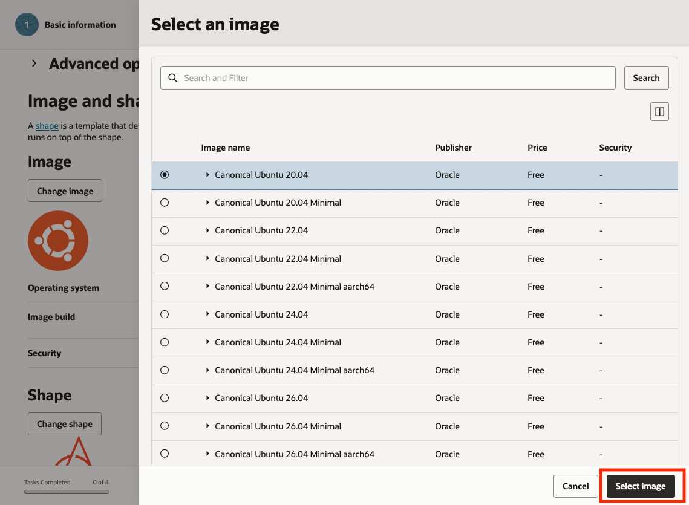
   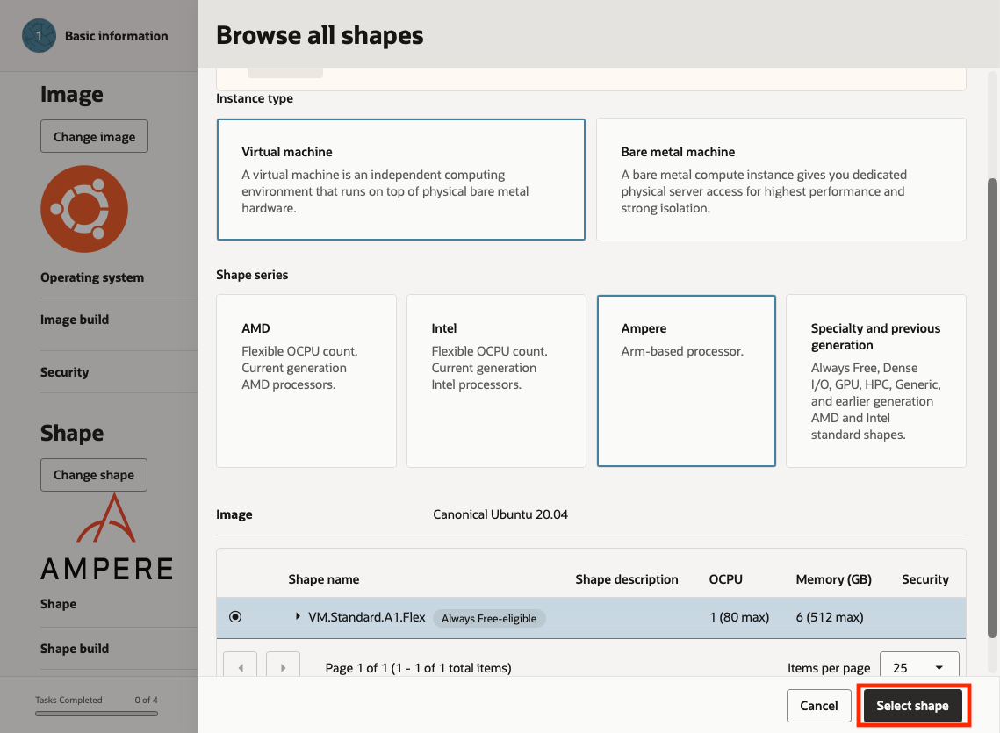

4. Cliquez sur **Next** en bas à droite.
5. Pour **Security**, cochez **Shield instance** et cliquez sur **Next**.

   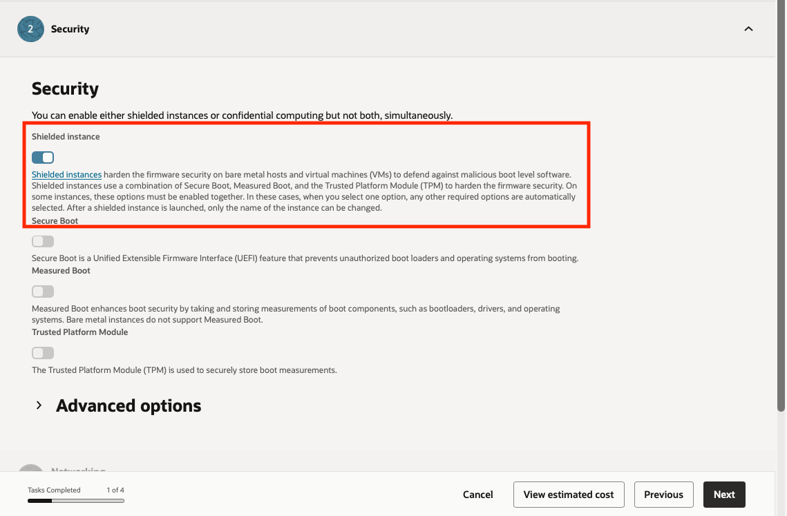

6. **Networking** : laissez Oracle créer un nouveau réseau (VCN) avec un sous-réseau public, et vérifiez que **Assign a public IPv4 address** est coché.

   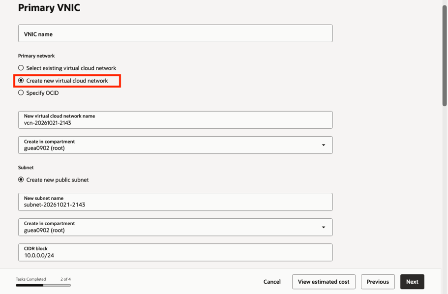
   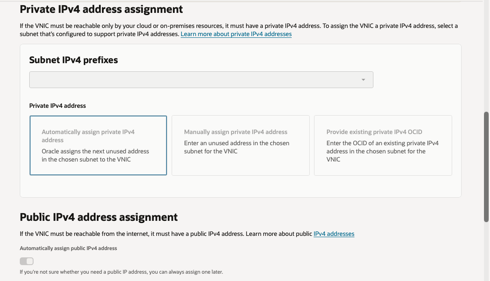

7. **Add SSH keys** : choisissez **Generate a key pair for me** et cliquez sur **Save private key**. Gardez ce fichier précieusement : c'est la seule façon de vous connecter à la VM.

   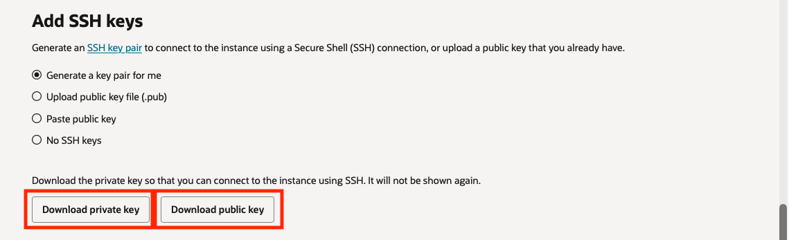

8. **Boot volume** : cochez **Specify a custom boot volume size** et mettez **100 Go** (le défaut de 50 Go est juste avec les images Docker et le modèle OCR). L'offre gratuite donne 200 Go au total.

   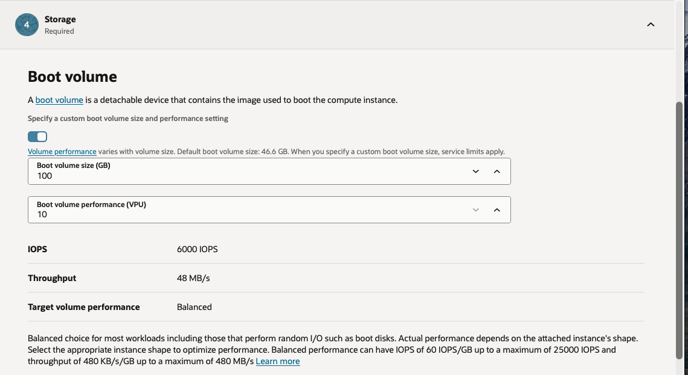

9. Cliquez sur **Create**. Quand l'état passe à **Running**, notez l'adresse IP publique affichée sur la page de l'instance.

> [!WARNING]
> Si Oracle affiche « Out of capacity », il n'y a plus de machines ARM gratuites dans cette zone pour le moment. Essayez un autre **Availability domain** dans la section **Placement**, ou réessayez plus tard. Il est aussi possible de prendre une machine payante : pour le premier mois, Oracle donne 400 $ CAD de crédit pour tester ses produits (testé avec une VM.Standard.E2.2, 2 OCPU et 16 Go de mémoire).

## 3. Ouvrir les ports 80 et 443 dans Oracle

Oracle a son propre pare-feu, en dehors de la VM : la *Security List*. Par défaut, il bloque tout sauf SSH (port 22). Il faut ouvrir 80 (HTTP, nécessaire pour obtenir le certificat) et 443 (HTTPS).

1. Ouvrez le menu ☰ en haut à gauche → **Networking** → **Virtual cloud networks**, puis cliquez sur le VCN créé avec la VM.

   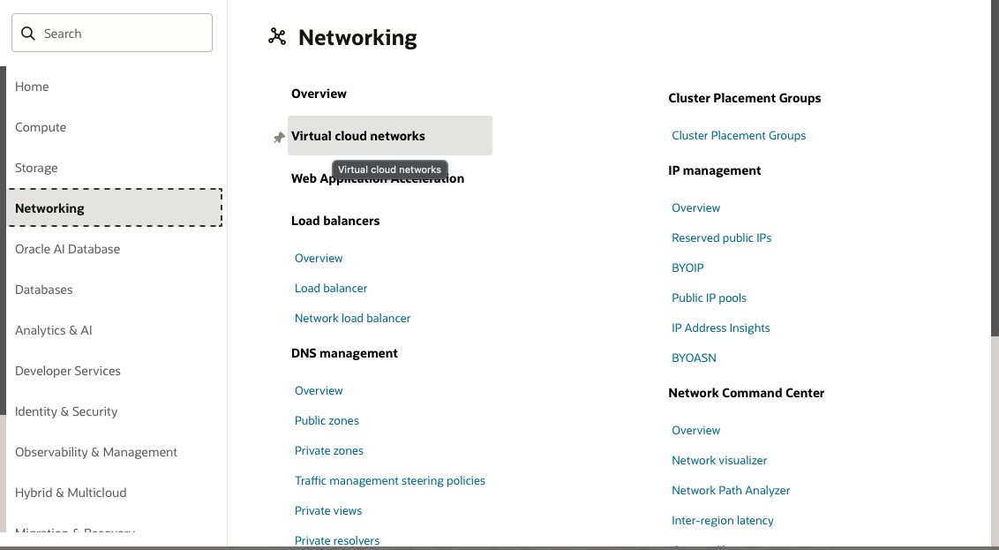
   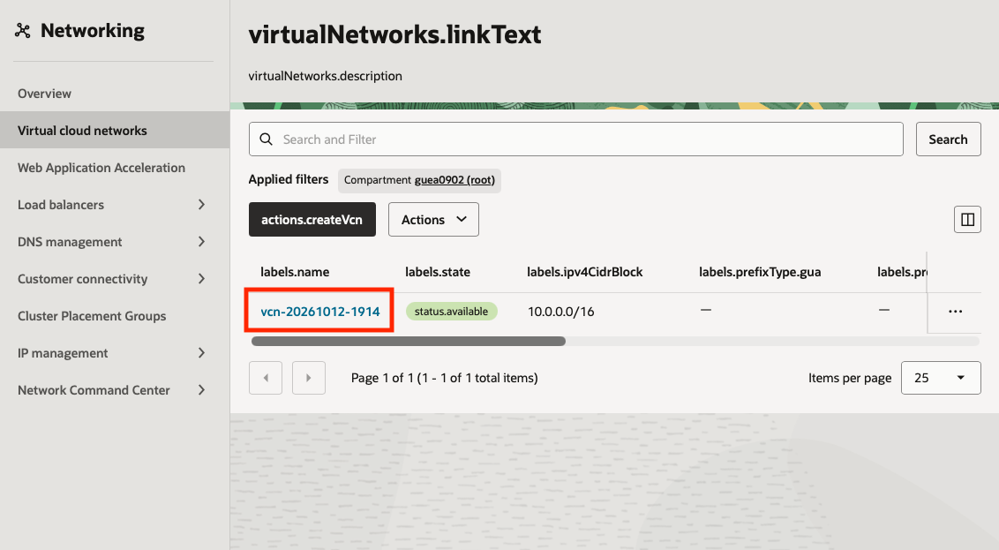

2. Cliquez sur **Security** dans la section réseau.

   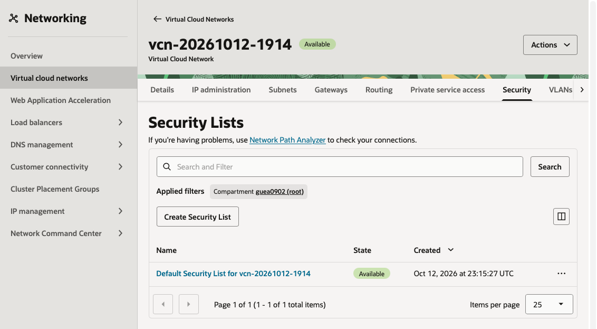

3. Onglet **Security Lists** → cliquez sur la liste par défaut (*Default Security List for …*).

   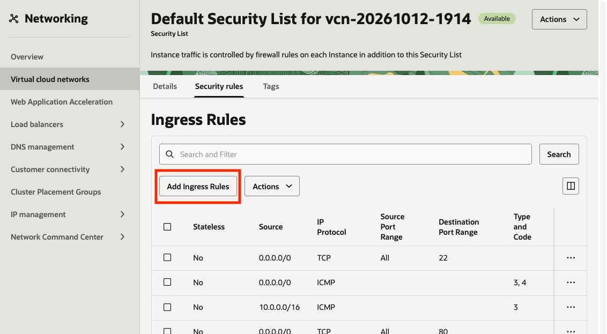

4. Onglet **Security rules** → **Add Ingress Rules**, et ajoutez une règle pour chaque port :
   - **Source CIDR** : `0.0.0.0/0`
   - **IP Protocol** : TCP
   - **Destination Port Range** : `80`, puis une deuxième règle avec `443`

   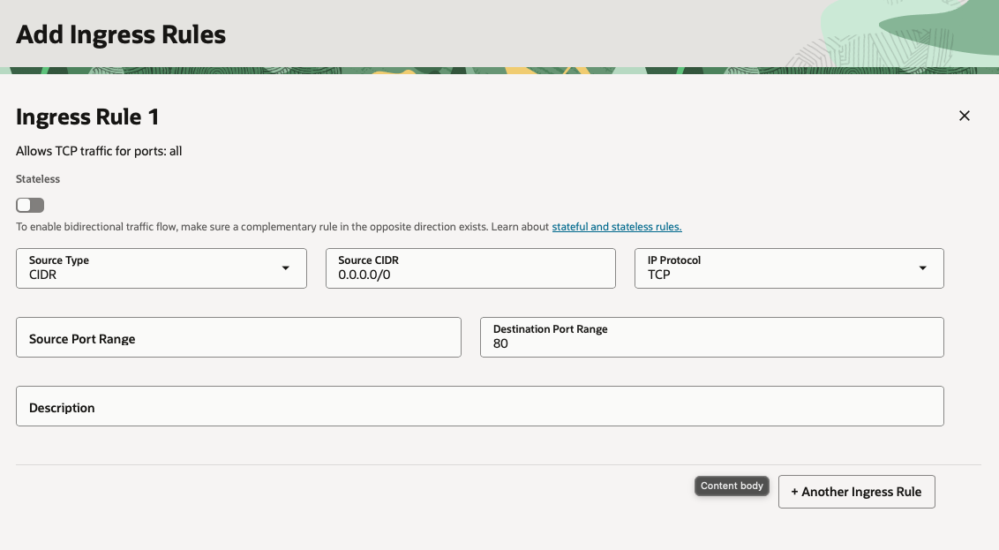

> [!NOTE]
> Le pare-feu à l'intérieur de la VM (iptables) est ouvert automatiquement par `deploy.sh`. Vous n'avez rien à faire de ce côté.

## 4. Se connecter à la VM en SSH

### macOS et Linux

Déplacez la clé téléchargée à un endroit sûr, puis limitez ses permissions (SSH refuse une clé lisible par tout le monde) :

```bash
mkdir -p ~/.ssh
mv ~/Downloads/ssh-key-*.key ~/.ssh/atlas.key
chmod 400 ~/.ssh/atlas.key
ssh -i ~/.ssh/atlas.key ubuntu@<ip>
```

### Windows (PowerShell)

```powershell
mkdir $HOME\.ssh -Force
Move-Item $HOME\Downloads\ssh-key-*.key $HOME\.ssh\atlas.key
ssh -i $HOME\.ssh\atlas.key ubuntu@<ip>
```

Si Windows affiche « UNPROTECTED PRIVATE KEY FILE », retirez l'accès aux autres utilisateurs :

```powershell
icacls $HOME\.ssh\atlas.key /inheritance:r /grant:r "$($env:USERNAME):R"
```

À la première connexion, SSH demande de confirmer l'empreinte du serveur : tapez `yes`. Vous êtes connecté quand l'invite ressemble à `ubuntu@atlas:~$`.

## 5. Installer Docker et récupérer le code

### Installer Docker

`deploy.sh` n'installe pas Docker : il s'arrête s'il ne le trouve pas. Sur la VM :

```bash
curl -fsSL https://get.docker.com | sudo sh
sudo usermod -aG docker $USER
exit
```

La commande `usermod` vous donne le droit d'utiliser Docker sans `sudo`. Elle ne prend effet qu'à la prochaine connexion : reconnectez-vous en SSH, puis vérifiez :

```bash
docker compose version
```

La commande doit afficher une version, sans erreur de permission.

### Récupérer le code

```bash
git clone https://github.com/AtlasPMC68/Atlas.git atlas
cd atlas
```

## 6. Premier déploiement

```bash
./deploy.sh
```

Le script pose deux questions, seulement la première fois :

- **CARTO API key** : collez la clé CARTO (ou laissez vide pour l'ajouter plus tard dans le `.env`).
- **Email for Let's Encrypt** : votre adresse courriel.

### Ce que fait le script

- Installe les paquets qui manquent (curl, git, openssl…).
- Détecte l'IP publique et construit l'adresse `https://<ip>.nip.io`.
- Ouvre les ports 80 et 443 dans le pare-feu de la VM.
- Crée le fichier `.env` avec des mots de passe aléatoires (seulement s'il n'existe pas). Il note aussi votre IP actuelle comme seule IP autorisée sur la console admin Keycloak.
- Sauvegarde la base de données (sauf au tout premier déploiement, où elle n'existe pas encore).
- Construit les images et démarre les conteneurs, puis attend qu'ils soient tous en bonne santé. La première construction prend plusieurs minutes.
- Si tout va bien, affiche `[SUCCESS]` et enregistre cette version comme « dernière version qui marche ».

### Vérifier que tout fonctionne

- Ouvrez `https://<ip>.nip.io` dans le navigateur : la page d'accueil d'Atlas doit s'afficher, avec un cadenas (HTTPS valide).
- `https://<ip>.nip.io/api/ping` doit répondre `pong`.
- Créez un compte avec **S'inscrire** sur la page de connexion, puis connectez-vous.

Sur la VM, l'état des services :

```bash
docker compose ps
```

Tous les services doivent être `running` ou `healthy`, sauf `migrate`, qui s'arrête normalement après son travail (`exited (0)`).

## 7. Après le premier déploiement

### Sauvegarder le fichier `.env` (important)

Le `.env` contient tous les mots de passe générés (base de données, Keycloak). Si vous le perdez, vous perdez l'accès à la base de données. Il n'est jamais envoyé sur GitHub. Copiez-le sur votre ordinateur, **depuis votre ordinateur** (pas depuis la VM) :

```bash
scp -i ~/.ssh/atlas.key ubuntu@<ip>:~/atlas/.env ./atlas-env-sauvegarde
```

> [!CAUTION]
> Ne commitez jamais ce fichier, et ne le partagez pas dans un canal public.

### Se connecter à la console admin Keycloak

Adresse : `https://<ip>.nip.io/auth/admin`. L'utilisateur est `admin`. Pour voir le mot de passe, sur la VM :

```bash
grep KEYCLOAK_ADMIN_PASSWORD ~/atlas/.env
```

La console n'est accessible que depuis les IP listées dans `ADMIN_ALLOWED_IPS` (dans le `.env`). Les autres reçoivent `403 Forbidden`. Au premier déploiement, c'est l'IP depuis laquelle vous étiez connecté en SSH.

### Votre IP a changé (403 sur la console admin)

L'IP d'une connexion à la maison change souvent. Trouvez votre IP actuelle (sur votre ordinateur : `curl ifconfig.me`), puis sur la VM :

```bash
cd ~/atlas
nano .env        # modifier la ligne ADMIN_ALLOWED_IPS=<nouvelle ip>
docker compose up -d caddy
```

Plusieurs IP sont possibles, séparées par des espaces : `ADMIN_ALLOWED_IPS=1.2.3.4 5.6.7.8`.

## 8. Mettre à jour l'application

### Déploiement automatique

Une fois mis en place (voir plus bas), il n'y a rien à faire : **chaque merge dans `main` est déployé tout seul**.

1. GitHub Actions lance les tests (job `tests` de [`ci.yml`](../../.github/workflows/ci.yml)).
2. S'ils passent, le job `deploy` se connecte à la VM en SSH et lance [`scripts/ci-deploy.sh`](../../scripts/ci-deploy.sh) avec le commit à déployer.
3. Sur la VM, le script se place sur ce commit et lance `./deploy.sh` : sauvegarde de la base, construction, migrations, attente que tout soit en bonne santé.
4. GitHub vérifie enfin que `https://<ip>.nip.io/api/ping` répond.

Le `.env` est conservé, les nouvelles migrations sont appliquées, et les données ne sont pas touchées.

On suit le déploiement dans l'onglet **Actions** du dépôt sur GitHub (workflow **CI - Atlas Project Tests**, job `deploy`). Une copie des messages est aussi gardée sur la VM dans `~/atlas/backups/ci-deploy.log`.

| Ce qui arrive | Résultat |
|---|---|
| Les tests échouent | Rien n'est déployé, le site garde la version actuelle. |
| `deploy.sh` échoue (migration ratée, service qui ne démarre pas…) | `rollback.sh` est lancé automatiquement : le site revient à la dernière version qui marchait. Le job est rouge. Corrigez, puis mergez à nouveau. |
| Le test final (`/api/ping`) échoue | La nouvelle version tourne, mais le site ne répond pas de l'extérieur. Voir la [partie 9](#9-quand-quelque-chose-ne-va-pas), en commençant par `docker compose logs caddy`. |
| Deux merges très rapprochés | Ils sont déployés l'un après l'autre, jamais en même temps. Si le plus récent est déployé en premier (ses tests ont fini avant), l'autre est ignoré : la production ne revient jamais à un commit plus ancien. |

Pour redéployer sans nouveau merge : onglet **Actions** → **CI - Atlas Project Tests** → **Run workflow** sur la branche `main`.

> [!NOTE]
> La clé SSH utilisée par GitHub ne peut **que** lancer `scripts/ci-deploy.sh`, et ce script refuse tout commit qui n'est pas sur `main`. Même si le secret fuitait, personne ne pourrait ouvrir un terminal sur la VM avec cette clé. Elle permettrait seulement de relancer le déploiement d'un commit de `main` : les commits plus anciens que la version en production sont refusés.
>
> Le vrai point sensible est ailleurs : tout ce qui est mergé dans `main` s'exécute sur la VM avec les droits `sudo` et `docker`. N'importe qui pouvant merger dans `main` peut donc lancer du code sur le serveur. C'est pour cela que l'étape 6 (tests obligatoires, et idéalement une revue obligatoire avant chaque merge) compte vraiment.

### Mettre en place le déploiement automatique (une seule fois)

À faire après le premier déploiement ([partie 6](#6-premier-déploiement)), et une fois que `scripts/ci-deploy.sh` est dans `main`.

> [!IMPORTANT]
> On crée une **nouvelle** clé SSH, réservée à GitHub. N'utilisez pas votre clé personnelle (`atlas.key`) : elle donne un accès complet à la VM, et elle reste votre accès d'administration.

**Étape 1 : mettre la VM sur `main`.** Connecté en SSH sur la VM :

```bash
cd ~/atlas
git fetch origin main
git checkout -- keycloak/atlas-frontend.json
git checkout --detach origin/main
ls scripts/ci-deploy.sh      # doit exister
```

**Étape 2 : créer la clé de déploiement.** Toujours sur la VM :

```bash
ssh-keygen -t ed25519 -N "" -C github-deploy -f ~/github-deploy
echo "restrict,command=\"$HOME/atlas/scripts/ci-deploy.sh\" $(cat ~/github-deploy.pub)" >> ~/.ssh/authorized_keys
```

La deuxième ligne autorise la clé, mais seulement pour lancer `ci-deploy.sh` (`restrict` interdit aussi le terminal et les redirections de ports).

**Étape 3 : récupérer ce qu'il faut mettre dans GitHub.** Toujours sur la VM :

```bash
cat ~/github-deploy                                                  # clé privée → DEPLOY_SSH_KEY
echo "<ip> $(cut -d' ' -f1,2 /etc/ssh/ssh_host_ed25519_key.pub)"     # empreinte du serveur → DEPLOY_KNOWN_HOSTS
```

L'empreinte permet à GitHub de vérifier qu'il parle bien à votre VM, et pas à un autre serveur.

**Étape 4 : configurer GitHub.** Sur la page du dépôt : **Settings** → **Environments** → **New environment**, nommez-le exactement `production`. Dans cet environnement :

- **Deployment branches and tags** : choisissez **Selected branches and tags** et ajoutez `main`.
- **Environment secrets** → **Add environment secret** :
  - `DEPLOY_SSH_KEY` : toute la clé privée de l'étape 3, lignes `-----BEGIN…` et `-----END…` comprises.
  - `DEPLOY_KNOWN_HOSTS` : la ligne `<ip> ssh-ed25519 AAAA…` de l'étape 3.
- **Environment variables** → **Add environment variable** :
  - `DEPLOY_HOST` : l'IP de la VM, par exemple `140.238.1.2`.
  - `DEPLOY_DOMAIN` : `<ip>.nip.io`, par exemple `140.238.1.2.nip.io`.

**Étape 5 : supprimer la clé privée de la VM.** Elle est maintenant dans GitHub, elle n'a rien à faire sur le serveur :

```bash
rm ~/github-deploy ~/github-deploy.pub
```

**Étape 6 : exiger les tests avant un merge.** **Settings** → **Rules** → **Rulesets** (ou **Branches**) → règle sur `main` avec **Require status checks to pass**, et ajoutez le check `tests`. Sinon, un merge qui casse les tests n'est pas déployé, mais il reste dans `main`. Cochez aussi idéalement **Require a pull request before merging** avec au moins une approbation : chaque merge dans `main` finit en production.

**Étape 7 : tester.** Onglet **Actions** → **CI - Atlas Project Tests** → **Run workflow** sur `main`. Le job `deploy` doit finir en vert.

### Déployer à la main

Toujours possible, par exemple si GitHub Actions est en panne. Sur la VM, dans `~/atlas` :

```bash
./scripts/ci-deploy.sh $(git ls-remote origin refs/heads/main | cut -f1)
```

C'est exactement ce que fait GitHub, avec le retour arrière automatique en cas d'échec. Pour essayer une autre branche sur le serveur, `git checkout <branche> && git pull && ./deploy.sh` fonctionne encore. Le prochain merge dans `main` la remplacera.

### Couper le déploiement automatique

- **Temporairement** : onglet **Actions** → **CI - Atlas Project Tests** → **⋯** → **Disable workflow** (les tests ne tournent plus non plus). Ou ajoutez une règle **Required reviewers** à l'environnement `production` : chaque déploiement attend alors une approbation.
- **Définitivement, ou si la clé a fuité** : sur la VM, supprimez la ligne qui finit par `github-deploy` dans `~/.ssh/authorized_keys`. La clé ne sert plus à rien.

> [!CAUTION]
> Ne lancez jamais `docker compose down -v` sur le serveur : l'option `-v` supprime les volumes, donc toute la base de données et les comptes utilisateurs.

## 9. Quand quelque chose ne va pas

### Diagnostiquer

Si un service ne démarre pas, `deploy.sh` s'arrête avec `[ERROR] Deployment failed` et affiche l'état des services. Pour voir les logs :

```bash
docker compose ps -a                     # état de tous les services
docker compose logs --tail 50 backend    # 50 dernières lignes d'un service
docker compose logs -f caddy             # suivre en direct (Ctrl+C pour quitter)
```

Noms des services : `caddy`, `frontend`, `backend`, `migrate`, `db`, `keycloak`, `keycloak-db`, `redis`, `celery-worker`, `celery-worker-ocr`, `florence-worker`, `flower`.

### Revenir à la version précédente (rollback)

Si la nouvelle version est cassée, mais que les données sont correctes (le cas le plus fréquent) :

```bash
./rollback.sh
```

Le script revient à la dernière version qui s'est déployée avec succès et la redéploie. Il ne touche pas à la base de données. Avec le [déploiement automatique](#déploiement-automatique), c'est déjà fait tout seul quand `deploy.sh` échoue. Il ne reste à le lancer à la main que si la version déployée démarre mais se comporte mal.

Une fois le bug corrigé, le merge dans `main` redéploie automatiquement. Sans déploiement automatique :

```bash
git checkout main
git pull
./deploy.sh
```

> [!NOTE]
> `rollback.sh` ne fonctionne qu'après au moins un déploiement réussi. Après un rollback, le dépôt est sur un commit précis (« detached HEAD ») : c'est normal, et c'est aussi l'état normal après un déploiement automatique.

### Problèmes fréquents

| Problème | Cause et solution |
|---|---|
| `./deploy.sh: Permission denied` | Le fichier n'est pas exécutable. Lancez `chmod +x deploy.sh rollback.sh`. Si ça revient après un `git pull`, le script a été commité sans le bit exécutable (voir la note ci-dessous). |
| Le job `deploy` échoue avec `Permission denied` | `scripts/ci-deploy.sh` a été commité sans le bit exécutable (voir la note ci-dessous). |
| `permission denied while trying to connect to the Docker daemon` | La session SSH date d'avant `usermod`. Déconnectez-vous et reconnectez-vous. |
| Le site ne répond pas du tout (délai dépassé) | Les ports 80 et 443 ne sont pas ouverts dans la Security List Oracle ([partie 3](#3-ouvrir-les-ports-80-et-443-dans-oracle)). |
| Le navigateur affiche une erreur de certificat | Caddy n'a pas obtenu le certificat. Vérifiez les ports 80/443 et que `ACME_EMAIL` dans le `.env` est une vraie adresse, puis `docker compose logs caddy`. |
| `.env still contains default credentials` | Le `.env` a été copié depuis `.env.example`. Supprimez-le (`rm .env`) au premier déploiement, puis relancez `./deploy.sh`. |
| Keycloak : `Invalid user credentials` dans les logs | Le mot de passe admin du `.env` ne correspond plus à celui créé au premier démarrage. Restaurez le `.env` d'origine (votre sauvegarde). |
| `403` sur `/auth/admin` | Votre IP n'est pas dans `ADMIN_ALLOWED_IPS` ([partie 7](#votre-ip-a-changé-403-sur-la-console-admin)). |
| `service "migrate" didn't complete successfully` | Une migration SQL a échoué et a été annulée. Lisez `docker compose logs migrate`, corrigez le fichier, redéployez. |
| Disque plein | Supprimez les anciennes images : `docker image prune -a`. N'ajoutez jamais `--volumes`. |

> [!IMPORTANT]
> **Scripts `.sh` ajoutés depuis Windows.** Windows ne connaît pas le bit exécutable, et Git y est configuré pour l'ignorer (`core.fileMode=false`). Un nouveau script est donc commité en `100644` au lieu de `100755`, et le serveur refuse de le lancer. Le CI vérifie ce point et échoue si un `.sh` n'est pas exécutable. Pour vérifier et corriger (`chmod` ne suffit pas sous Windows) :
>
> ```bash
> git ls-files -s '*.sh'                      # chaque ligne doit commencer par 100755
> git update-index --chmod=+x <script>.sh     # puis commitez le changement
> ```

## 10. Base de données

### Modifier le schéma : les migrations

Les changements de base de données sont des fichiers SQL dans `Backend-Atlas/db/`. À chaque démarrage, le service `migrate` applique seulement les nouveaux fichiers, dans l'ordre des noms (`01_`, `02_`, …), et les note dans la table `schema_migrations`.

Pour ajouter un changement :

1. Créez un fichier avec le numéro suivant, par exemple `Backend-Atlas/db/07_ajout_colonne.sql`.
2. Écrivez le changement, par exemple `ALTER TABLE users ADD COLUMN display_name TEXT;`
3. Testez en local avec `docker compose up -d`, puis vérifiez `docker compose logs migrate`.
4. Commitez, poussez, et déployez avec `git pull && ./deploy.sh`.

Deux règles :

- **Ne modifiez jamais un fichier déjà appliqué.** Les bases qui l'ont déjà exécuté ne verront pas le changement (`migrate` affiche un avertissement). Créez un nouveau fichier.
- **Chaque fichier s'exécute en une seule transaction** : s'il échoue, rien n'est gardé, le backend ne démarre pas, et `docker compose logs migrate` montre l'erreur.

### Les sauvegardes automatiques

Avant chaque déploiement, `deploy.sh` copie la base dans `~/atlas/backups/`, par exemple `atlas-20261021-195500-a1adf68.sql.gz` (date, heure, puis version du code). Les 7 dernières sont gardées.

> [!WARNING]
> Ces sauvegardes sont sur la même VM que la base. Elles protègent contre un mauvais déploiement, pas contre la perte de la VM. Avant un changement risqué, copiez la dernière sur votre ordinateur :
>
> ```bash
> scp -i ~/.ssh/atlas.key ubuntu@<ip>:~/atlas/backups/<fichier>.sql.gz .
> ```

La base Keycloak (comptes utilisateurs) n'est pas incluse dans ces sauvegardes. Pour tout récupérer avant de perdre la VM, voir la [partie 12](#12-quitter-le-serveur-ou-changer-de-vm).

### Restaurer une sauvegarde

Seulement si une version a abîmé les données. Tout ce qui a été écrit depuis la sauvegarde est perdu. Sur la VM, dans `~/atlas` :

```bash
ls -1t backups/                  # la plus récente en premier
docker compose stop backend celery-worker celery-worker-ocr
git checkout <commit-du-nom-du-fichier>
docker compose exec -T db sh -c 'dropdb -U "$POSTGRES_USER" --force "$POSTGRES_DB" && createdb -U "$POSTGRES_USER" "$POSTGRES_DB"'
gunzip -c backups/<fichier>.sql.gz | docker compose exec -T db sh -c 'psql -X -q -v ON_ERROR_STOP=1 -U "$POSTGRES_USER" "$POSTGRES_DB"'
./deploy.sh
```

Le commit est la dernière partie du nom du fichier (`a1adf68` dans l'exemple) : c'est la version du code qui correspond à ces données.

## 11. Entretien du serveur

- **Oracle peut récupérer une VM gratuite inactive.** Si l'utilisation du CPU, du réseau et de la mémoire reste sous 20 % pendant 7 jours, Oracle peut arrêter l'instance. Pour l'éviter, passez le compte en **Pay As You Go** (menu **Billing** → **Upgrade and Manage Payment**) : les ressources Always Free restent gratuites.
- **Mises à jour d'Ubuntu** : de temps en temps, `sudo apt update && sudo apt upgrade -y`. Ubuntu installe déjà les correctifs de sécurité automatiquement (`unattended-upgrades`).
- **Espace disque** : `df -h /`. S'il dépasse 80 %, voir « Disque plein » dans la [partie 9](#problèmes-fréquents).
- **Arrêter Atlas sans rien perdre** : `docker compose down` (sans `-v`). Pour le relancer : `./deploy.sh`.

## 12. Quitter le serveur ou changer de VM

À faire **avant** de perdre la VM : fin du crédit d'essai Oracle, suppression de l'instance, passage à une autre VM ou à un autre compte. Une VM payante (par exemple la VM.Standard.E2.2 de l'essai) est arrêtée quand le crédit est épuisé, puis supprimée avec son disque. Tout ce qui est dessus disparaît.

> [!WARNING]
> Les sauvegardes automatiques de la [partie 10](#les-sauvegardes-automatiques) ne suffisent pas : elles restent sur la VM, et elles ne contiennent ni la base Keycloak (comptes utilisateurs) ni les images téléversées.

### Ce qu'il faut récupérer

- **La base Atlas** (service `db`) : toutes les données de l'application.
- **La base Keycloak** (service `keycloak-db`) : les comptes et mots de passe des utilisateurs.
- **Les images téléversées** : le volume `media-data`, monté dans `/app/media` du backend.
- **Le fichier `.env`** : les mots de passe. Sans lui, les sauvegardes sont difficiles à remettre en place.
- **La version du code** (commit) qui correspond à ces données.

### Étape 1 : tout exporter sur la VM

Connecté en SSH sur la VM :

```bash
cd ~/atlas
mkdir -p ~/export
docker compose exec -T db sh -c 'pg_dump -U "$POSTGRES_USER" "$POSTGRES_DB"' | gzip > ~/export/atlas-db.sql.gz
docker compose exec -T keycloak-db sh -c 'pg_dump -U "$POSTGRES_USER" "$POSTGRES_DB"' | gzip > ~/export/keycloak-db.sql.gz
docker compose exec -T backend tar czf - -C /app/media . > ~/export/media.tar.gz
cp .env ~/export/env
git rev-parse --short HEAD > ~/export/commit.txt
ls -lh ~/export
```

Aucun fichier ne doit faire 0 octet. Si une commande affiche une erreur, vérifiez que les services tournent (`docker compose ps`).

### Étape 2 : copier sur votre ordinateur

Depuis votre ordinateur (pas depuis la VM) :

```bash
scp -r -i ~/.ssh/atlas.key ubuntu@<ip>:~/export ./atlas-export
```

Vérifiez que le dossier `atlas-export` contient les cinq fichiers. Ensuite seulement, la VM peut être supprimée.

> [!CAUTION]
> Le fichier `env` contient tous les mots de passe. Ne le commitez jamais et ne le partagez pas dans un canal public.

### Restaurer sur une nouvelle VM

Suivez les parties 2 à 5 (créer la VM, ouvrir les ports, se connecter, installer Docker, cloner le code), mais **ne lancez pas encore `./deploy.sh`**. Envoyez d'abord l'export sur la nouvelle VM, depuis votre ordinateur :

```bash
scp -r -i ~/.ssh/atlas.key ./atlas-export ubuntu@<nouvelle-ip>:~/export
```

Sur la nouvelle VM, remettez le `.env`, placez-vous sur la même version du code, puis déployez :

```bash
cd ~/atlas
cp ~/export/env .env && chmod 600 .env
git checkout $(cat ~/export/commit.txt)
./deploy.sh
```

> [!NOTE]
> `deploy.sh` voit que l'IP a changé et met à jour l'adresse nip.io dans le `.env` tout seul. Pensez par contre à mettre votre IP actuelle dans `ADMIN_ALLOWED_IPS` ([partie 7](#votre-ip-a-changé-403-sur-la-console-admin)).

Quand le déploiement affiche `[SUCCESS]`, les bases sont vides. Remettez les images, puis les deux bases :

```bash
docker compose exec -T backend tar xzf - -C /app/media < ~/export/media.tar.gz
docker compose stop backend celery-worker celery-worker-ocr keycloak
docker compose exec -T db sh -c 'dropdb -U "$POSTGRES_USER" --force "$POSTGRES_DB" && createdb -U "$POSTGRES_USER" "$POSTGRES_DB"'
gunzip -c ~/export/atlas-db.sql.gz | docker compose exec -T db sh -c 'psql -X -q -v ON_ERROR_STOP=1 -U "$POSTGRES_USER" "$POSTGRES_DB"'
docker compose exec -T keycloak-db sh -c 'dropdb -U "$POSTGRES_USER" --force "$POSTGRES_DB" && createdb -U "$POSTGRES_USER" "$POSTGRES_DB"'
gunzip -c ~/export/keycloak-db.sql.gz | docker compose exec -T keycloak-db sh -c 'psql -X -q -v ON_ERROR_STOP=1 -U "$POSTGRES_USER" "$POSTGRES_DB"'
./deploy.sh
```

Le dernier `./deploy.sh` redémarre tout. Au redémarrage, Keycloak met à jour les adresses de connexion avec la nouvelle IP. Vérifiez ensuite qu'un ancien compte peut se connecter et que les données sont là.

Pour revenir sur la branche après coup : `git checkout <branche>`, puis `git pull && ./deploy.sh`.

## Aide-mémoire

| Je veux… | Commande (sur la VM, dans `~/atlas`) |
|---|---|
| Me connecter à la VM | `ssh -i ~/.ssh/atlas.key ubuntu@<ip>` (depuis mon ordinateur) |
| Déployer une nouvelle version | Merger dans `main` (automatique) |
| Redéployer `main` à la main | `./scripts/ci-deploy.sh $(git ls-remote origin refs/heads/main \| cut -f1)` |
| Lire le journal des déploiements automatiques | `tail -n 100 backups/ci-deploy.log` |
| Revenir à la version précédente | `./rollback.sh` |
| Voir l'état des services | `docker compose ps -a` |
| Lire les logs d'un service | `docker compose logs --tail 50 <service>` |
| Voir le mot de passe admin Keycloak | `grep KEYCLOAK_ADMIN_PASSWORD .env` |
| Autoriser ma nouvelle IP sur l'admin | modifier `ADMIN_ALLOWED_IPS` dans `.env`, puis `docker compose up -d caddy` |
| Lister les sauvegardes | `ls -1t backups/` |
| Copier une sauvegarde chez moi | `scp -i ~/.ssh/atlas.key ubuntu@<ip>:~/atlas/backups/<fichier> .` |
| Arrêter Atlas | `docker compose down` (jamais `-v`) |

## Fichiers importants

- [`deploy.sh`](../../deploy.sh) : installation et mise à jour du serveur.
- [`rollback.sh`](../../rollback.sh) : retour à la dernière version qui marche.
- [`scripts/ci-deploy.sh`](../../scripts/ci-deploy.sh) : déploiement automatique, lancé par GitHub Actions (le seul script que la clé de déploiement peut lancer).
- [`.github/workflows/ci.yml`](../../.github/workflows/ci.yml) : tests, puis déploiement après chaque merge dans `main`.
- `.env` : configuration et mots de passe du serveur (généré, jamais commité).
- [`docker-compose.yml`](../../docker-compose.yml) : tous les services. [`docker-compose.prod.yml`](../../docker-compose.prod.yml) : réglages ajoutés en production seulement.
- [`Caddyfile`](../../Caddyfile) : HTTPS et redirection vers les services.
- [`Backend-Atlas/db/`](../../Backend-Atlas/db/) : migrations SQL et `migrate.sh`.
- `backups/` : sauvegardes de la base, `last-good-commit` et `ci-deploy.log`.
